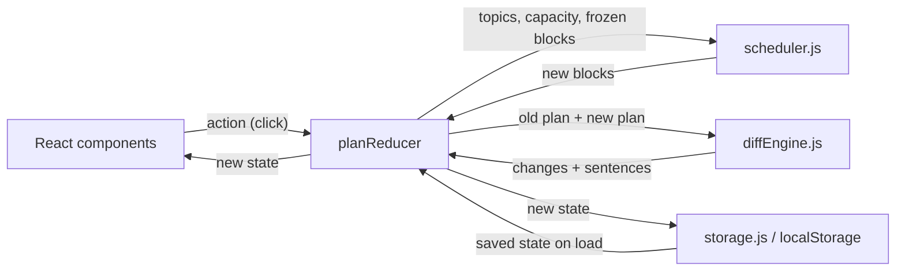

# ExamPilot — Technical Spec

## How This Works, In Plain Language

ExamPilot is a single web page that runs entirely in your browser. There is no server, no login, and no AI API.

It has four pieces:

1. **The screen (React components).** What you see and click: the setup form, the day cards, the "I fell behind" button, and the banners. Components only *display* the plan and *report* what you clicked. They never calculate the schedule themselves.
2. **The brain (`scheduler.js`).** A plain JavaScript function. You give it your topics, your remaining study time, and what you've already finished. It gives back a day-by-day plan. Same input → same output, every time (that's what "deterministic" means). Because it has no React inside it, we can test it directly with numbers.
3. **The narrator (`diffEngine.js`).** After the brain makes a new plan, the narrator lays the old plan and the new plan side by side, finds every real difference ("Graphs lost 2h on Day 1, gained 1h on Day 3 and 1h on Day 4"), and turns those differences into sentences. It only describes what actually changed.
4. **The memory (`storage.js`).** Saves your plan to `localStorage` — a sticky note the browser keeps for this one site — after every change, and reads it back when you return. If the note is damaged or from an old version, it safely starts fresh instead of crashing.

A small "traffic controller" (`planReducer.js`) connects them: when you click something, it asks the brain for a new plan, asks the narrator what changed, and hands the result to the screen and the memory.

**All time is counted in half-hour units.** 1 unit = 30 minutes, so 4 hours = 8 units. Every input only accepts multiples of 0.5 hours, so every calculation is whole-number math. There is no rounding step anywhere, which means rounding can never sneak extra time into a day.

**Why this shape:** it's the smallest structure that keeps the hard logic (scheduling, explaining) separate from the UI, so the kernel can be tested without clicking through the app.

## The Core Journey Through the System

PRD ref: `prd.md > The Core Journey`.



1. **Open the app** → `App` calls `storage.load()` → nothing saved → the empty state shows the setup form and "Load Sample Exam".
2. **Load sample / fill form + Generate** → `validateSetup()` → reducer `GENERATE` → `scheduler.generatePlan()` → day cards appear with either the "Plan fits" badge (plus any review buffer) or the Triage banner → `storage.save()`.
3. **Check off a block** → reducer `TOGGLE_BLOCK` marks it `completed` → `recalculate()` → `diffPlans()` → progress updates; a Recovery banner appears only if the remaining schedule actually changed → saved.
4. **Mark topic mastered** → reducer `MARK_MASTERED` → topic's remaining effort becomes 0 → `recalculate()` → `diffPlans()` → Recovery banner explains where the freed time went → saved.
5. **I fell behind** → dialog asks for hours → `validateMissed()` → reducer `REPORT_MISSED` adds to today's missed units → `recalculate()` → `diffPlans()` → Recovery banner + updated cards → saved.
6. **Edit setup** → confirmation "This will reset your current plan and progress" → Cancel: nothing changes → Confirm: form opens prefilled; submitting runs `GENERATE` for a fresh plan.
7. **Come back later** → `storage.load()` validates the saved data → if the calendar day has moved on, reducer `DAY_ADVANCED` treats unchecked past blocks as missed and recalculates, with its own banner.
8. **Reset** → confirm → `storage.clear()` → empty state.

## Stack

| Piece | Choice | Docs | Why (learner-agreed) |
|---|---|---|---|
| UI framework | React (latest stable at scaffold, expected 19.x) | https://react.dev | Learner already knows React. |
| Build tool / dev server | Vite (latest stable) + `@vitejs/plugin-react` | https://vite.dev | Instant dev server, static build, no backend. |
| Styling | Tailwind CSS v4 via `@tailwindcss/vite` | https://tailwindcss.com/docs | Learner knows Tailwind; theme tokens in CSS. |
| Font | Inter, self-hosted via `@fontsource-variable/inter` | https://fontsource.org/fonts/inter | Clean editorial sans; works offline. |
| Logic tests | Vitest | https://vitest.dev | Same config as Vite; tests the pure modules directly. |
| UI interaction tests | React Testing Library + `@testing-library/user-event` + jsdom | https://testing-library.com/docs/react-testing-library/intro | Runs real clicks headlessly, asserting rendered allocations. |

No state library, router, date library, or schema library.

> [!NOTE]
> Versions weren't looked up for this spec. The build's first step must scaffold with current stable versions and confirm the Tailwind v4 Vite plugin setup matches its docs.

## Where It Runs and How Someone Tries It

- **Runtime:** browser only. Node.js (learner has v24) for development.
- **API keys:** none.
- **Start:** `npm install`, then `npm run dev`, open the printed `http://localhost:5173`.
- **Tests:** `npm test` (Vitest runs logic + UI interaction tests).
- **Demo recording:** run locally, click **Load Sample Exam**, follow **Golden Demo Scenario**.
- **Submission:** short demo video + public GitHub repository are both required. Deployment is optional (static Vite build works on Netlify/Vercel/GitHub Pages); decided in `6-ship`.

## Look and Feel

Carried from `prd.md > Look and Feel` and `scope.md > Inspiration & Identity`.

- **Palette (Tailwind v4 `@theme` tokens in `src/index.css`):**
  - `paper` `#FAF8F4` warm off-white background (matches the learner's "warm off-white" direction; the PRD's example hex values read cool).
  - `surface` `#FFFFFF` cards; `line` `#E7E3DC` hairline borders.
  - `ink` `#0F172A` (slate-900) text; `ink-muted` `#475569` (slate-600) secondary.
  - `accent` `#4F46E5` (indigo-600) primary buttons/focus; `accent-soft` `#EEF2FF`.
  - `warn` amber-700 on amber-50 (Triage); `risk` rose-700 on rose-50 (At risk / Missed); `done` emerald-700 on emerald-50 (completed / plan fits).
- **Typography:** Inter variable. Quiet, large headings (semibold, slight negative tracking); body 15–16px; `tabular-nums` on every hour value.
- **Density:** generous spacing (`p-5`/`p-6`, `gap-6`), `rounded-xl`, one soft `shadow-sm`, 1px borders. No gradients; transitions ≤150ms on color/opacity only.
- **Copy tone:** calm, direct, honest. "You have 12h left and 13h of work. 1h won't fit — here's what's at risk." Never scolding, never falsely upbeat.
- **Layout:** two columns on `lg` (setup/summary/topics left ~380px, schedule right); single stacked column on mobile.
- **Accessibility basics:** real `<label>`s, visible focus rings, native checkboxes, color never the only signal (badges carry text).

## Components

### `App`
Holds `useReducer(planReducer)`; loads from storage on mount; saves after every state change; checks for day advance on mount. Chooses empty vs. plan layout.
PRD ref: `prd.md > Screens and Layout`, `prd.md > 6. Persistence & State Management`.

### `Header`
Wordmark, exam subject, countdown ("4 days until exam" / "Exam day"), overall progress bar.
PRD ref: `prd.md > Screens and Layout`.

### `ExamSetupForm`
Subject, exam date, daily hours, 3–6 topic rows (name, confidence 1–5 segmented buttons, importance select, estimated hours step 0.5), add/remove topic, **Generate Study Plan**, **Load Sample Exam** (labeled "Sample"). Inline errors from `validateSetup()`.
PRD ref: `prd.md > 1. Exam Configuration & Sample Preload`.

### `ExamSummary` and `ConfirmDialog`
After a plan exists the form collapses to a read-only summary with **Edit setup**. Edit opens `ConfirmDialog`: "Editing your exam will reset this plan and your progress. Continue?" **Cancel** closes it with state untouched; **Continue** shows the form prefilled with the current setup; submitting dispatches `GENERATE` (fresh plan). `ConfirmDialog` is reused by Reset.
PRD ref: `prd.md > Product Decisions` (editing setup resets the plan).

### `TopicProgressList`
Per topic: name, priority badge, `completed / estimated` hours bar, "Done" or "Mastered" tag, At-risk badge with unallocated hours, **Mark mastered** / **Undo**.
PRD ref: `prd.md > 4. Progress Tracking (Daily Blocks & Topics)`.

### `FeasibilityBanner`
Plan fits: emerald badge "Plan fits your available time" + review buffer total if any. Triage: amber panel with Needed / Available / Shortfall hours, the at-risk topics with how much of each won't fit, and one sentence of advice naming the top-priority topics to protect.
PRD ref: `prd.md > 3. Honest Feasibility & Triage Feedback`.

### `RecoveryBanner`
Renders `state.lastChange`: heading by event ("Plan updated after 2h missed"), the diff engine's sentences, and shortfall before → after. Dismissible.
PRD ref: `prd.md > 5. Adaptive Recovery & Real Schedule Diff Derivation`.

### `ScheduleView` and `DayCard`
`DayCard`s from Day 1 to the last study day. Each: label ("Day 2 · Tue 13 Oct"), "Today" tag, used / available hours ("4 / 4h"), missed hours if any, `StudyBlock` rows, and a "Review buffer Xh" row when the day has free capacity. Past days muted.
PRD ref: `prd.md > Screens and Layout`, `prd.md > 2. Intelligent Prioritized Schedule Generation`.

### `StudyBlock`
Checkbox, topic name, hours, priority badge. States: planned; completed (emerald check); missed (past + planned → rose "Missed" tag; checkbox still allowed for "I actually did it"). A check that would break the day's capacity (e.g., after missed hours) is refused with an inline message.
PRD ref: `prd.md > 4. Progress Tracking (Daily Blocks & Topics)`.

### `MissedTimeDialog`
Opened by **I fell behind**. Number input (step 0.5, min 0.5, max = today's free hours). Shows "Today you have Xh not yet completed or reported missed." Confirm dispatches `REPORT_MISSED`. Disabled with an explanation when today's free hours are 0 or the exam day has arrived.
PRD ref: `prd.md > 5. Adaptive Recovery & Real Schedule Diff Derivation`.

### `CompletionCard`, `ExamDayCard`, `EmptyState`
All remaining work done → congratulations. Today ≥ exam date → "Exam day — good luck" summary; scheduling disabled. No plan → intro + form + sample button.
PRD ref: `prd.md > States and Boundaries`.

### `Footer`
**Reset plan** (via `ConfirmDialog`) and a note that data stays in this browser.
PRD ref: `prd.md > 6. Persistence & State Management`.

## Data Model

All persisted state is one object in `localStorage` under key `exampilot:v1`.

```js
// PlanState (persisted)
{
  version: 1,
  exam: {
    subject: "CS 201: Data Structures",
    examDate: "2026-10-16",       // local YYYY-MM-DD
    planStartDate: "2026-10-12",  // local YYYY-MM-DD; Day 1 = this date
    dailyUnits: 8                 // half-hour units per day (4h)
  },
  topics: [
    { id: "t1", name: "Trees", confidence: 1, importance: "high",
      estimatedUnits: 10, mastered: false }
  ],
  blocks: [
    { id: "b1", dayIndex: 0, topicId: "t1", units: 4,
      status: "planned" | "completed" }
  ],
  missedUnitsByDay: { "0": 4 },   // dayIndex -> units reported missed that day
  lastScheduledDayIndex: 0,       // todayIndex at the last (re)schedule
  nextId: 12,                     // block id counter (deterministic in tests)
  lastChange: null | {
    event: "missed" | "mastered" | "unmastered" | "checked" | "unchecked" | "dayAdvanced",
    dayIndex: 0,
    lines: ["You lost 2h today, so Day 1 has no study time left.", "..."],
    deficitBeforeUnits: 0,
    deficitAfterUnits: 2
  }
}
```

**Days.** Study days run from `planStartDate` up to the day **before** `examDate`. `numDays = daysBetween(planStartDate, examDate)`. `todayIndex = daysBetween(planStartDate, today())`; `today()` is injected so tests use a fixed date.

**Time accounting for a day `d`.** A day's `dailyUnits` is split into four non-overlapping parts:
`completedUnitsOnDay(d)` + `missedUnitsByDay[d]` + `plannedUnitsOnDay(d)` + `reviewBufferUnits(d)` = `dailyUnits` (for `d ≥ todayIndex`).
Completed and missed time can never overlap: reporting missed time is limited to the time not already completed, and checking a block is refused if it would exceed what's left after missed time.

**Derived values (never stored; `derive(state, todayIndex)` in `scheduler.js`):**

| Value | Formula |
|---|---|
| `completedUnits(topic)` | sum of that topic's `completed` blocks |
| `remainingUnits(topic)` | `0` if `mastered`, else `max(0, estimatedUnits − completedUnits)` |
| `dayCapacity(d)` (for `d ≥ todayIndex`) | `max(0, dailyUnits − missedUnitsByDay[d] − completedUnitsOnDay(d))`; past days = 0 |
| `plannedFutureUnits(topic)` | that topic's `planned` blocks with `dayIndex ≥ todayIndex` |
| `unallocatedUnits(topic)` | `remainingUnits − plannedFutureUnits` (≥ 0 by invariant) |
| `deficitUnits` | Σ `unallocatedUnits` |
| `atRisk(topic)` | `unallocatedUnits > 0` |
| `reviewBufferUnits(d)` | `dayCapacity(d) − plannedUnitsOnDay(d)` for `d ≥ todayIndex` |
| `neededUnits` / `availableUnits` | Σ `remainingUnits` / Σ `dayCapacity(d)` |
| `topicDone(topic)` | `mastered` or `completedUnits ≥ estimatedUnits` |
| `progress` | Σ completed ÷ (Σ completed + Σ remaining); mastering removes that topic's remaining units from the denominator |

Deficit, at-risk, and buffer are derived from the stored blocks, so banners can never disagree with the day cards.

**Where it lives / updates / survives:** React state, replaced only by reducer actions, written to `localStorage` after every action; read, validated, and (if the date moved) rescheduled on return.

## Scheduling Algorithm (`src/lib/scheduler.js`)

Implements `prd.md > 2. Intelligent Prioritized Schedule Generation` and `prd.md > 3. Honest Feasibility & Triage Feedback`.

### Priority and ranking
```
importanceWeight: high = 3, medium = 2, low = 1
priority(topic)  = importanceWeight × (6 − confidence)      // 1..15
```
**Tie-break (used for every ranking):** higher priority → lower confidence → earlier position in the topic list. Remaining effort is **not** part of priority; it only sets how much time a topic needs.

Sample: Trees 3×5 = **15**, Graphs 3×4 = **12**, Sorting 2×3 = **6**, Arrays 2×2 = **4**.

**Exam urgency** is handled by behavior, not the formula: the ranking decides who gets the earliest days (Step 4), and when the plan fits, leftover time collects at the end as a **review buffer** before the exam.

### Step 1 — Freeze what can't change
Keep every `completed` block (any day) and every block on a past day (`dayIndex < todayIndex`). Discard every `planned` block with `dayIndex ≥ todayIndex`; these are regenerated.

### Step 2 — Capacity and need
`dayCapacity(d)` for each `d` in `[todayIndex, numDays)`; `C = Σ dayCapacity`. Active topics: `remainingUnits > 0`. `N = Σ remainingUnits`.

### Step 3 — Budgets (total units per topic)
**Precedence (highest first):** daily capacity → total remaining capacity → a topic's remaining need → the 1h floor → priority fill. A lower rule never overrides a higher one.
- **Fits (`N ≤ C`):** `budget = remainingUnits` for every topic.
- **Triage (`N > C`):**
  1. **Starvation floor (soft):** in rank order, give each active topic `min(remainingUnits, 2, capacityLeft)` units (target 1h). It's a target, not a guarantee: if capacity runs out, the lowest-ranked topics get less than 1h or nothing and are reported at risk. The floor never creates time and never pushes a day over its capacity.
  2. **Priority fill:** hand out remaining capacity one unit at a time to the active topic with the highest `priority × (1 − budget / remainingUnits)` among topics with `budget < remainingUnits` (ties → tie-break). High-priority topics fill first, but the score drops as they fill, so others keep receiving time.
- Guarantees: `budget ≤ remainingUnits`; `Σ budget = min(N, C)`.

### Step 4 — Placement (which day)
For each day `d` from `todayIndex` forward, fill up to `dayCapacity(d)`:
1. **Pass 1:** in rank order, give each topic up to `4 − frozenUnits(topic, d)` units (2h per topic per day, counting any completed time for that topic already on that day), limited by its remaining budget and the day's room.
2. **Pass 2:** if room remains, fill in rank order ignoring the 2h cap.

One `planned` block per topic per day. Days are filled completely before moving on, so all budget is placed (`Σ budget ≤ C`) and any unused capacity appears only on the **final** days as the review buffer.

### Step 5 — Return
Frozen blocks + new planned blocks (ids from `nextId`), `lastScheduledDayIndex = todayIndex`.

### Public functions
`priority`, `rankTopics`, `derive`, `computeBudgets(activeTopics, C)`, `placeBudgets(budgets, dayCapacities, frozenByDay, rankedIds, startDay)`, `generatePlan(setup, today)`, `recalculate(state, todayIndex)`.

### Invariants (checked by `assertInvariants(state, todayIndex)` in tests)
1. For every `d ≥ todayIndex`: completed + missed + planned ≤ `dailyUnits`.
2. Completed blocks are deep-equal before and after any recalculation.
3. A mastered topic has no `planned` block with `dayIndex ≥ todayIndex`.
4. For every topic: `plannedFutureUnits ≤ remainingUnits`.
5. `Σ plannedFutureUnits = min(N, C)` and `deficitUnits = max(0, N − C)`.
6. Every `units` value is a positive integer; `missedUnitsByDay` values are non-negative integers.
7. Review buffer > 0 on any day ⇒ `deficitUnits = 0`.
8. Same input twice → deep-equal output.
9. **No double counting:** for every non-mastered topic, `completedUnits + plannedFutureUnits + unallocatedUnits = max(estimatedUnits, completedUnits)` — each unit of a topic's estimate is exactly one of completed, planned, or at risk. For every day, completed units are subtracted from that day's capacity exactly once.
10. **Soft floor:** in Triage, a topic below the 1h floor is allowed only if every higher-ranked topic received its floor and capacity is exhausted.

### Completed-work immutability
Completed blocks are never inputs to placement: Step 1 copies them unchanged, Step 4 only creates `planned` blocks, and the reducer is the only code that can change a block's `status` (via an explicit user check/uncheck). Recovery therefore can't move, shrink, or reassign completed time, and completed hours are subtracted from a topic's need once and from their own day's capacity once.

## Recovery Behavior

Implements `prd.md > 5. Adaptive Recovery & Real Schedule Diff Derivation` and `prd.md > 4. Progress Tracking (Daily Blocks & Topics)`.

- **Missed hours (`REPORT_MISSED`, `h` hours → `u = 2h` units):** valid if `1 ≤ u ≤ todayFree`, where `todayFree = dailyUnits − missedUnitsByDay[today] − completedUnitsOnDay(today)`. Planned-but-unchecked blocks today don't reduce `todayFree` — they are exactly the time being reported lost. Then `missedUnitsByDay[today] += u` → `recalculate()`. Only unfinished work moves, and only into capacity that genuinely exists.
- **Checking a block (`TOGGLE_BLOCK` → completed):** refused if `completedUnitsOnDay(d) + missedUnitsByDay[d] + block.units > dailyUnits`. Otherwise mark completed → `recalculate()` → banner only if the diff isn't empty. Blocks on future days may be checked ("studied ahead"); they stay on their day and use that day's capacity.
- **Unchecking (`TOGGLE_BLOCK` → planned):** returns to planned → `recalculate()` (a past-day block becomes missed work and is redistributed).
- **Mastered / Undo (`MARK_MASTERED` / `UNMASTER`):** toggle flag → `recalculate()` → banner explains where freed (or reclaimed) time went. Completed blocks of that topic stay and keep counting.
- **Day advanced (`DAY_ADVANCED`, on load when `todayIndex > lastScheduledDayIndex`):** unchecked past blocks stay visible as Missed; their topics' remaining effort is unchanged, so the recalculation moves that work into remaining days.
- **Zero remaining capacity (`C = 0`, `N > 0`):** no planned blocks, deficit = N, every active topic at risk; banner: "No study time left before the exam"; dialog disabled.
- **Exam day or later (`todayIndex ≥ numDays`):** all scheduling actions disabled; `ExamDayCard`.

## Diff Engine (`src/lib/diffEngine.js`)

Implements `prd.md > 5. Adaptive Recovery & Real Schedule Diff Derivation`.

`diffPlans(before, after, { event, todayIndex, missedUnits?, topicId? })` → `{ changes, lines, deficitBeforeUnits, deficitAfterUnits }`

1. **Maps:** `units[topicId][dayIndex]` of `planned` blocks with `dayIndex ≥ todayIndex` for `before` and `after`; per-topic `unallocatedUnits`, total deficit, and `reviewBufferUnits` per day for each.
2. **Per-topic changes:** removals (days where units fell, with amounts), additions (days where units rose), risk before/after.
3. **Pairing:** match removals to additions earliest-day-first to form moves; leftover removals become cuts; leftover additions become gains.
4. **Ordering:** event line first; then topics by total units moved/cut/gained, descending (ties → tie-break); then buffer, risk, and shortfall lines.
5. **Sentence templates** (filled only from computed numbers; any template with a zero amount is skipped):
   - Event — missed: "You lost {h} today, so Day {n} has {free} of study time left." / "…has no study time left." mastered: "{Topic} marked mastered — {h} freed up." unmastered: "{Topic} is back in the plan — needs {h}." dayAdvanced: "{h} planned before today wasn't checked off, so it was rescheduled."
   - Move: "{Topic}: {h} moved from Day {a} to Day {b}."
   - Cut: "{Topic}: cut from {x} to {y} on Day {d}."
   - Gain: "{Topic}: +{h} on Day {d}."
   - Buffer: "Day {d} review buffer: {x} → {y}."
   - Risk: "{Topic} is now at risk — {h} won't fit." / "{Topic} is no longer at risk."
   - Shortfall: "Shortfall grew from {a} to {b}." / "Shortfall shrank from {a} to {b}." / "Everything fits again."
   - No differences → only "Your remaining schedule didn't need to change." (and for `checked` events, no banner).
6. `formatHours(units)`: 1 → "0.5h", 2 → "1h", 5 → "2.5h".

No text is written for a specific scenario. The structured `changes` object is the source of truth; sentences are rendered from it:

```js
changes = {
  capacity: [{ day, beforeUnits, afterUnits }],           // days whose capacity changed
  topics: [{ topicId,
    moves: [{ fromDay, toDay, units }],
    cuts:  [{ day, beforeUnits, afterUnits }],
    gains: [{ day, units }],
    riskBeforeUnits, riskAfterUnits }],
  buffers: [{ day, beforeUnits, afterUnits }],
  deficit: { beforeUnits, afterUnits }
}
```

Tests assert `changes` exactly (numbers), and assert `lines` with targeted checks (right count of lines per kind, each line names the right topic/day/hours), not full-sentence equality.

## Validation (`src/lib/validation.js`)

`validateSetup(form, today)` → `{ ok, errors: { field: message } }`

| Field | Rule |
|---|---|
| subject | trimmed, 1–60 chars |
| examDate | valid date, 1–14 days after today (PRD range; 3–7 is the target scenario) |
| dailyHours | 0.5–12, multiple of 0.5 |
| topics | 3–6 rows |
| topic name | trimmed, 1–40 chars, unique (case-insensitive) |
| confidence | integer 1–5 |
| importance | `high` / `medium` / `low` |
| estimatedHours | 0.5–20, multiple of 0.5 |

`validateMissed(hours, todayFreeUnits)`: multiple of 0.5, from 0.5 to `todayFreeUnits / 2`.

## Persistence (`src/lib/storage.js`)

Implements `prd.md > 6. Persistence & State Management`.

- `save(state)`: `localStorage.setItem("exampilot:v1", JSON.stringify(state))` in try/catch; failure → non-blocking "Couldn't save in this browser" note; app keeps working in memory.
- `load()` → `{ state | null, notice | null }`:
  1. Missing key → `{ null, null }`.
  2. `JSON.parse` fails, `isValidPlanState()` fails, or `version !== 1` → copy raw string to `exampilot:v1:corrupt`, remove the main key, notice "Your saved plan couldn't be read, so ExamPilot started fresh."
- `isValidPlanState(x)`: required fields and types; enums; positive integer units; every block's `topicId` exists; `dayIndex` in `[0, numDays)`; invariant 1 for every day; `examDate > planStartDate`. Any failure = invalid (no partial repair).
- `clear()`: removes the main key and the corrupt backup.
- Future versions bump `version` and add a `migrate` step; v1 has none.

## Sample Exam (`src/lib/sampleExam.js`)

Labeled "Sample" in the UI. `buildSampleSetup(today)` returns a normal setup that goes through `validateSetup` → `generatePlan`, exactly like user input.

- "CS 201: Data Structures", exam date = today + 4 (4 study days), **4h/day** (16h available).
- Trees (high, conf 1, 5h) · Graphs (high, conf 2, 5h) · Sorting (medium, conf 3, 3h) · Arrays (medium, conf 4, 2h). Needed 15h.

Why 4h/day: the agreed demo completes a 2h block **and** reports 2h missed on Day 1. That's 4h of Day 1 accounted for with no overlap; at 3h/day it would double-count time.

### Golden Demo Scenario (computed by hand from the algorithm; pinned exactly in tests)

**Initial plan — fits.** Needed 15h, available 16h, shortfall 0h, review buffer 1h on Day 4.

| Day | Blocks | Buffer |
|---|---|---|
| 1 | Trees 2h · Graphs 2h | — |
| 2 | Trees 2h · Graphs 2h | — |
| 3 | Trees 1h · Graphs 1h · Sorting 2h | — |
| 4 | Sorting 1h · Arrays 2h | 1h |

**Step A — check Day 1 "Trees 2h".** Recalculation produces the identical remaining plan (the 2h cap counts the completed Trees time on Day 1), so no banner. Progress: 2h of 15h ≈ 13%.

**Step B — I fell behind → 2h.** Day 1 free time before: 4h − 2h completed = 2h, so 2h is valid. Day 1 capacity becomes 0 (2h completed + 2h missed). Remaining: Trees 3h, Graphs 5h, Sorting 3h, Arrays 2h = 13h needed vs 12h available (Days 2–4) → Triage. Budgets: Trees 3h, Graphs 5h, Sorting 2.5h, Arrays 1.5h.

| Day | Blocks | Buffer |
|---|---|---|
| 1 | Trees 2h ✓ (unchanged) · 2h missed | — |
| 2 | Trees 2h · Graphs 2h | — |
| 3 | Trees 1h · Graphs 2h · Sorting 1h | — |
| 4 | Graphs 1h · Sorting 1.5h · Arrays 1.5h | 0h |

**Expected explanation (generated, in order):**
1. You lost 2h today, so Day 1 has no study time left.
2. Graphs: 1h moved from Day 1 to Day 3.
3. Graphs: 1h moved from Day 1 to Day 4.
4. Sorting: 0.5h moved from Day 3 to Day 4.
5. Sorting: cut from 1.5h to 1h on Day 3.
6. Arrays: cut from 2h to 1.5h on Day 4.
7. Day 4 review buffer: 1h → 0h.
8. Sorting is now at risk — 0.5h won't fit.
9. Arrays is now at risk — 0.5h won't fit.
10. Shortfall grew from 0h to 1h.

Triage banner: 13h needed · 12h available · 1h short; protect Trees and Graphs first.

> [!NOTE]
> Lines 4–5 describe one Sorting change (2h → 1h on Day 3, 1h → 1.5h on Day 4) as a move plus a cut, which is how the pairing rule reports it. Tests use targeted assertions on the structured `changes` object and verify key topics, days, and amounts rather than brittle coupling to exact prose strings.

## State Actions (`src/state/planReducer.js`)

Pure `(state, action) → state`; `todayIndex`/`today` come in the action so the reducer never reads the clock.

| Action | Effect | Reschedule | Banner |
|---|---|---|---|
| `GENERATE {setup, today}` | fresh plan (also used after confirmed Edit) | yes | none (feasibility only) |
| `TOGGLE_BLOCK {blockId, todayIndex}` | flip status (refused if over capacity) | yes | only if diff non-empty |
| `MARK_MASTERED` / `UNMASTER {topicId, todayIndex}` | set flag | yes | yes |
| `REPORT_MISSED {units, todayIndex}` | add missed units | yes | yes |
| `DAY_ADVANCED {todayIndex}` | — | yes | yes |
| `DISMISS_CHANGE` | `lastChange = null` | no | — |
| `RESET` | state `null` | no | — |
| `HYDRATE {state}` | load saved state | no | — |

Edit-setup confirmation is UI-only state in `App`; Cancel dispatches nothing.

## File Structure

```
exampilot/
├── index.html
├── package.json
├── vite.config.js            # react + tailwind plugins; vitest (jsdom) config
├── README.md                 # what it is, run/test, demo script
├── .gitignore                # node_modules, dist, .env*, devpost/learner-profile.md
├── src/
│   ├── main.jsx              # mounts <App/>
│   ├── App.jsx               # useReducer, load/save, day-advance, edit-confirm, layout
│   ├── index.css             # @import "tailwindcss"; @theme tokens; font import
│   ├── lib/                  # pure logic — no React imports
│   │   ├── units.js          # hoursToUnits, unitsToHours, formatHours
│   │   ├── dates.js          # today(), toISODate, addDays, daysBetween (local)
│   │   ├── scheduler.js      # priority, rankTopics, derive, computeBudgets, placeBudgets, generatePlan, recalculate
│   │   ├── diffEngine.js     # diffPlans → changes + sentences
│   │   ├── validation.js     # validateSetup, validateMissed
│   │   ├── storage.js        # save, load, clear, isValidPlanState
│   │   └── sampleExam.js     # buildSampleSetup(today)
│   ├── state/
│   │   └── planReducer.js    # actions → scheduler + diffEngine
│   └── components/
│       ├── Header.jsx
│       ├── EmptyState.jsx
│       ├── ExamSetupForm.jsx
│       ├── ExamSummary.jsx
│       ├── ConfirmDialog.jsx
│       ├── TopicProgressList.jsx
│       ├── FeasibilityBanner.jsx
│       ├── RecoveryBanner.jsx
│       ├── ScheduleView.jsx
│       ├── DayCard.jsx
│       ├── StudyBlock.jsx
│       ├── MissedTimeDialog.jsx
│       ├── CompletionCard.jsx
│       ├── ExamDayCard.jsx
│       └── Footer.jsx
├── tests/
│   ├── helpers.js            # assertInvariants, fixed-date fixtures, blocksTable()
│   ├── units.test.js
│   ├── scheduler.test.js
│   ├── diffEngine.test.js
│   ├── validation.test.js
│   ├── storage.test.js
│   ├── planReducer.test.js
│   └── app.flow.test.jsx     # RTL golden demo, edit-confirm, persistence
└── devpost/                  # Devpost learning workspace
```

## Testing Plan

Tests assert **numbers** (allocations per day/topic, capacity use, deficits, completed blocks), not just that elements exist. `blocksTable(state)` turns a plan into `{ day: { topic: hours } }` so expected tables read like the ones above.

### Logic tests (Vitest)
- **units:** 4h ↔ 8 units; `formatHours(1) === "0.5h"`; non-0.5 multiples rejected.
- **scheduler**
  - *Feasible plan:* golden initial table exactly; deficit 0; Day 4 buffer 1h; invariants.
  - *Insufficient time:* 3 topics needing 10h, 2 days × 3h → exact budgets, shortfall 4h, lowest-ranked topics at risk; no day > 3h.
  - *Starvation floor:* 6 topics, 3h total → the 3 highest-ranked get exactly 1h each; the others get 0 and are at risk for their full estimate.
  - *Priority & tie-break:* equal priorities ordered by confidence then input order; running twice gives deep-equal output.
  - *Missed hours:* golden Step B table exactly; Day 1 capacity 0; invariants 1–10.
  - *Completion:* Step A leaves the remaining plan identical; completed blocks deep-equal across every recalculation; completed future block uses that day's capacity.
  - *Mastery:* mastering Arrays after Step B → no future Arrays blocks, freed 1.5h reallocated by priority, shortfall recomputed; Undo restores the Step B allocations exactly.
  - *Zero capacity:* all remaining days missed → no planned blocks, deficit = N, all active at risk.
  - *Exam day:* `todayIndex ≥ numDays` → no planned blocks, no crash.
  - *Day advanced:* unchecked Day 1 blocks counted as missed work and placed in Days 2+; Day 1 blocks themselves unchanged.
  - *Capacity guard:* checking a block that would exceed `dailyUnits − missed` is refused.
- **diffEngine**
  - Golden Step B: asserts structured `changes` (moves, cuts, risks, buffers, deficit) and verifies targeted phrases/values in rendered lines without brittle whole-string coupling.
  - A mastery scenario with different numbers produces corresponding structured changes and verified lines from the templates.
  - Identical plans → "didn't need to change"; `checked` with empty diff → no banner.
- **validation:** boundaries (0.5 / 12h; 2 vs 3 and 6 vs 7 topics; duplicate names; exam today and +15 days invalid; 0.25h invalid); missed > today's free rejected.
- **storage:** round-trip equality; malformed JSON → null + notice + backup; wrong version → reset; block exceeding day capacity → invalid; `setItem` throwing → no crash.
- **planReducer:** every action's transition and whether `lastChange` is set.

### UI interaction tests (React Testing Library, fixed date)
1. **Load Sample Exam** → Day cards show the golden initial hours; banner says the plan fits; Day 4 shows "Review buffer 1h".
2. Check Day 1 Trees → progress shows 13%; no Recovery banner; Day cards unchanged.
3. **I fell behind** → dialog says 2h free → enter 2 → confirm → Day 1 shows 0h free; Day 3/Day 4 hours match the Step B table; Triage shows 13h / 12h / 1h short; Recovery banner contains the generated lines.
4. Dialog rejects 2.5h (more than free) with a message.
5. **Mark mastered** Arrays → its Day 4 block disappears and the hours shown match the mastery test.
6. **Edit setup** → Cancel → plan and progress unchanged. Edit → Continue → submit → fresh plan, no completed blocks.
7. Unmount and re-render from `localStorage` → identical day cards, progress, and banner.
8. **Reset** → confirm → empty state; storage key removed.
9. Invalid form (2 topics, past date) → inline errors; no plan created.

### Manual browser checklist (final verification)
- Golden demo runs in under 60 seconds and on-screen numbers match the tables above.
- Desktop and ~390px mobile layouts both readable; columns stack on mobile.
- Refresh mid-flow keeps everything.
- Corrupt `exampilot:v1` in DevTools → fresh start with notice.
- Keyboard-only: all actions reachable, focus visible.

## External Services and Dependencies

None at runtime. No APIs, keys, accounts, rate limits, or costs. npm packages only (see **Stack**).

## Important Failure Modes

- **Saved data malformed or old version** → fresh start with notice; raw data kept in `exampilot:v1:corrupt`.
- **`localStorage` unavailable/full** → works in memory with a non-blocking note.
- **Return after the exam date** → `ExamDayCard`; scheduling disabled; Reset offered.
- **Timezone/late-night edge** → all dates are local `YYYY-MM-DD` compared by calendar day, never by milliseconds.

## What Was Simplified and Why

- **Whole-block completion** instead of partial-hour logging — keeps math integer and simple. Fuller version: "studied X of Y" per block.
- **Uniform daily hours** (minus per-day missed time) instead of per-weekday hours — one input, easy to demo. Fuller version: per-day capacity editor.
- **Editing setup starts a fresh plan** (learner-approved) instead of merging progress — avoids reconciliation logic.
- **Review buffer = unscheduled final-day time** instead of dedicated review sessions — protects pre-exam time with zero extra data. Fuller version: assign buffer to the highest-priority topics as named review blocks.
- **RTL interaction tests** instead of a real-browser E2E tool — no browser downloads; Playwright could be added later.
- **Hand-written validation** instead of a schema library — the schema is small.

## Decisions and Open Issues

### Learner decisions
- React + Vite + Tailwind; pure `scheduler.js`, `diffEngine.js`, `storage.js` separate from components.
- 0.5-hour granularity as integer half-hour units; never exceed daily or total capacity; unallocatable effort reported as shortfall.
- `priority = importanceWeight × (6 − confidence)`; remaining effort sets needed time, not priority; urgency handled by early placement and a protected review buffer.
- Edit setup → confirmation → Cancel preserves, Continue creates a fresh plan; no merging.
- Testing: Vitest (logic), React Testing Library (interactions), manual browser checklist; tests assert real allocations and invariants.
- Golden demo keeps **2h missed** after a **2h completed** block; sample adjusted to 4h/day and 5/5/3/2h estimates so time isn't double-counted and the resulting shortfall is real.
- No auth, no external/paid APIs, localStorage only; local run + video; deployment optional.

### Implementation details derived by the agent
Weights 3/2/1; 1h starvation floor; 2h per-topic-per-day soft cap (counting completed time on that day); fill score `priority × (1 − budget/remaining)`; derived (not stored) deficit/at-risk/buffer; injected clock; storage key `exampilot:v1`; move/cut/gain pairing rule in the diff engine.

### Useful unknown (learner-raised): fractional hours
*Question:* how to keep schedules readable (no "1.37h") without rounding overbooking a day?
*Clarified:* store time as whole half-hour units and only accept 0.5h-multiple inputs. All math is integer, so no rounding happens and capacity checks are exact. *Evidence in build:* invariants 1, 5, 6.

### Cross-document consistency check (`scope.md`, `prd.md`, `spec.md`)
| Issue found | Resolution |
|---|---|
| Scope priority multiplied by remaining hours / days left | Scope updated to the agreed formula; urgency via placement + review buffer. |
| Sample at 3h/day couldn't hold 2h completed + 2h missed on Day 1 | PRD and scope sample updated to 4h/day, 15h needed; demo stays at 2h missed. |
| Scope demo implied initial triage; new sample starts feasible | Recovery now moves the plan from "fits" into Triage, which demonstrates both states. |
| Scope's "rapid review if time permits" vs. no review in PRD | Defined as the review buffer (unscheduled final-day time). |
| PRD "topic completed when allocated hours fulfilled" | PRD updated: done when completed ≥ estimated, or mastered. |
| PRD "recalculate when progress changes" vs. draft spec "no recalculation on check" | Spec now recalculates on every progress change; banner only when the diff isn't empty. |
| Scope "0.5–1h minimum" and "scale proportionally" | Fixed at a 1h floor + priority fill; scope updated. |
| PRD example explanation text didn't match any real scenario | Replaced with an excerpt of the golden output. |
| Missed vs. completed time could overlap | Time-accounting rule: missed ≤ free time; checks refused if they'd overlap missed time. |

### Open questions
None blocking. Carried from `prd.md > Open Questions`: resolved here.
